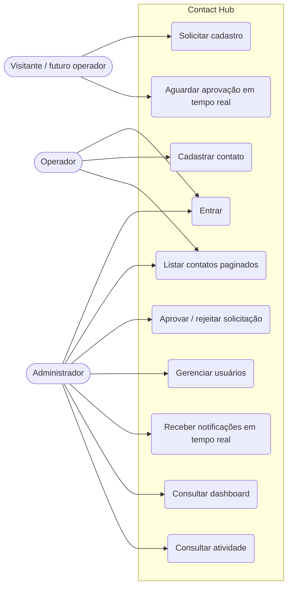
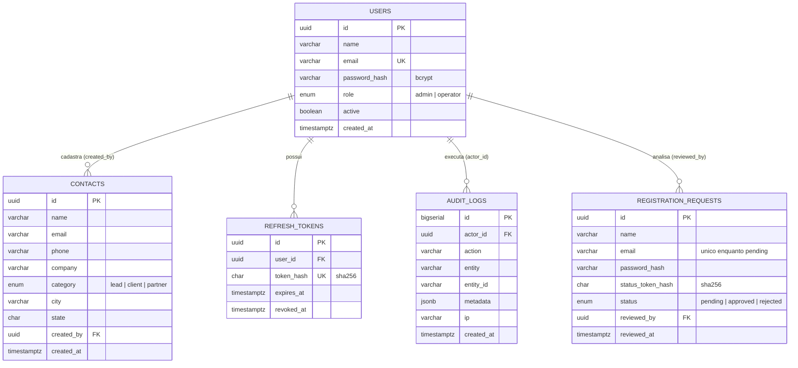
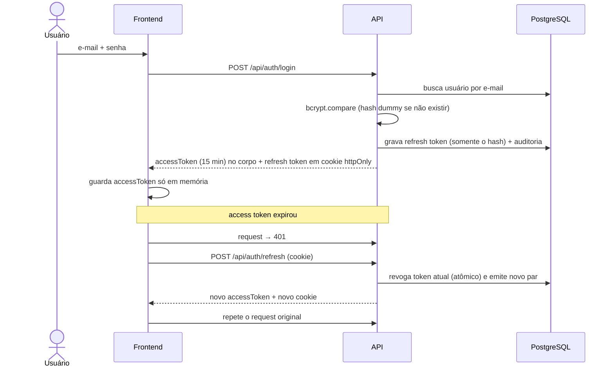
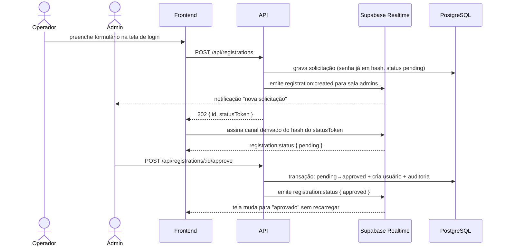
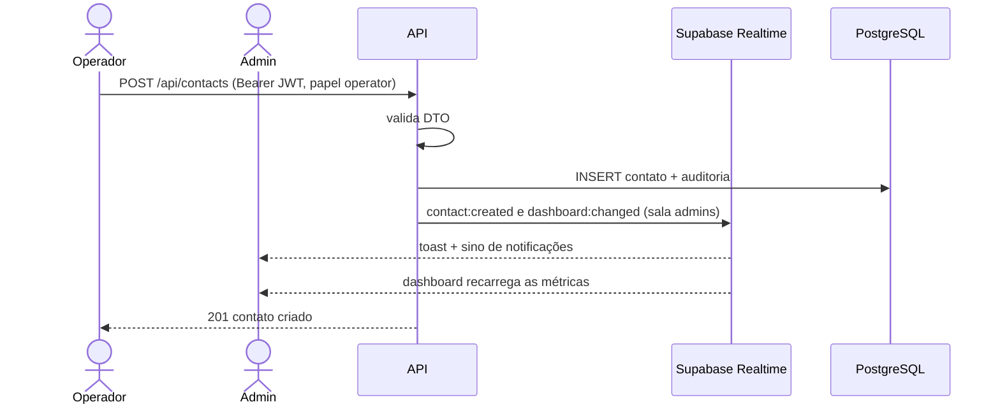
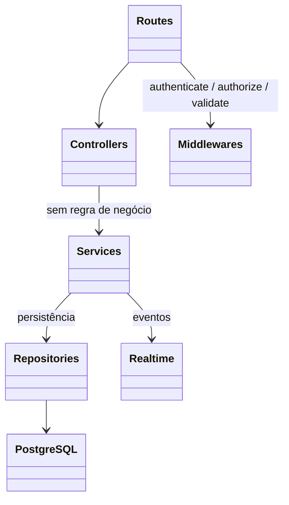

# Contact Hub — Análise de requisitos e System Design

Diagramas em [Mermaid](https://mermaid.js.org/) (renderizam no GitHub, VS Code e na maioria dos visualizadores de Markdown).

## 1. Requisitos

### 1.1 Funcionais

| ID | Requisito | Prioridade |
|----|-----------|------------|
| RF01 | Autenticação por e-mail e senha (tela de login) | Obrigatório |
| RF02 | Operador sem conta envia solicitação de cadastro pela tela de login | Obrigatório |
| RF03 | Operador aguarda a decisão do admin **em tempo real**, sem recarregar a tela | Obrigatório |
| RF04 | Admin recebe solicitações, aprova ou rejeita | Obrigatório |
| RF05 | Admin cadastra usuários diretamente e ativa/desativa contas | Obrigatório |
| RF06 | Operador cadastra contatos | Obrigatório |
| RF07 | Cada contato cadastrado gera notificação em tempo real ao admin | Obrigatório |
| RF08 | Admin e operador listam contatos, com **paginação no backend** | Obrigatório |
| RF09 | Admin consulta a atividade da aplicação (trilha de auditoria) | Obrigatório |
| RF10 | Dashboard do admin com métricas e dimensões, atualizado em tempo real | Extra |
| RF11 | Deploy reproduzível (Docker) | Extra |

### 1.2 Não funcionais

| ID | Requisito | Como é atendido |
|----|-----------|-----------------|
| RNF01 | Segurança de autenticação | JWT de acesso curto + refresh token rotativo (ver README) |
| RNF02 | Manutenibilidade | Camadas `routes → controllers → services → repositories`, DTOs validados, sem dependências desnecessárias |
| RNF03 | Escalabilidade | API stateless em serverless (Vercel); tempo real delegado ao Supabase Realtime |
| RNF04 | Auditabilidade | Tabela `audit_logs` para eventos de segurança e negócio |
| RNF05 | Portabilidade | Node 20+, PostgreSQL 13+, Docker opcional |

### 1.3 Premissas e decisões negociáveis

- Operador pode listar **todos** os contatos (a especificação pede lista para ambos os perfis). Se for necessário isolar por operador, basta filtrar por `created_by` no `contactRepository`.
- Um e-mail já cadastrado devolve `409` na solicitação. Isso permite enumerar e-mails; troca consciente por usabilidade (mitigada por rate limit de 5/hora por IP).
- Apenas o perfil **operador** cria contatos (o admin analisa).

## 2. Casos de uso



## 3. Arquitetura

```mermaid
    subgraph Vercel ["Vercel (Serverless)"]
        SPA["SPA Frontend (Static)<br/>HTML · CSS · ES Modules"]
        API["Express API (Serverless Function)<br/>Middlewares · Controllers · Services · Repositories"]
    end

    subgraph Supabase ["Supabase (PaaS)"]
        DB[("PostgreSQL 15+<br/>(Supabase Studio Web)")]
        RT["Supabase Realtime (Broadcast)<br/>canais isolados por segredo"]
    end

    SPA -- "HTTPS /api (Bearer JWT)" --> API
    API -- "TCP (pooler 6543)" --> DB
    API -- "POST /broadcast" --> RT
    SPA -- "WSS (WebSocket)" --> RT
```

## 4. Modelo de dados



## 5. Sequências

### 5.1 Login e renovação de sessão



### 5.2 Solicitação de cadastro com aprovação em tempo real



### 5.3 Cadastro de contato e notificação ao admin



## 6. Estrutura de camadas (backend)



Regras de dependência: cada camada só conhece a imediatamente abaixo; SQL só existe em `repositories/`; regras de negócio só em `services/`.

